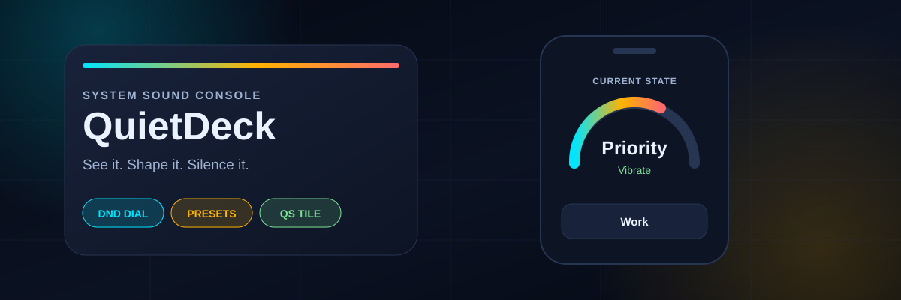

# QuietDeck

<p align="center">
  
</p>

A visual Do Not Disturb and sound-profile console for Android.

QuietDeck turns the Android system sound state into something you can actually see and control: one dark, glanceable deck with a live DND dial, ringer modes, quick presets, stream volumes, a Quick Settings tile, and a local action log.

## Why this exists

Android's sound controls are split across Settings, the volume panel, Quick Settings, and Bluetooth output sheets. QuietDeck puts the pieces in one place so you can answer three questions instantly:

- What is my phone doing right now?
- What happens if I silence it?
- How do I get back to normal without hunting through menus?

It works as a normal installed app. It also makes sense as a preinstalled system app on a custom ROM because it uses only public Android APIs and needs no root.

> [Download the latest APK](https://github.com/netherish/QuietDeck/releases/latest)

## Features

- **Live DND dial** showing Off, Priority only, Alarms only, or Total silence.
- **Focus presets**: Normal, Work, Sleep, Driving, Meeting, and Night Owl.
- **Ringer modes** with one tap: Normal, Vibrate, or Silent.
- **Stream volume sliders** for media, ring, and alarm.
- **Quick Settings tile** that toggles DND, or opens the deck when access is not granted yet.
- **Local action log** with timestamps — nothing leaves the device.
- **Dark visual system** with aurora background, gradient rings, and preset accents.

## Permissions

- `ACCESS_NOTIFICATION_POLICY` — required by Android to read or change Do Not Disturb. QuietDeck opens the system grant screen; it does not grant itself.
- `MODIFY_AUDIO_SETTINGS` — used for stream volume adjustments.

No account, no network calls, no analytics, no cloud sync.

## Build

```bash
./gradlew assembleDebug
```

The debug APK is written to `app/build/outputs/apk/debug/app-debug.apk`. GitHub Actions also builds and uploads a debug APK artifact on every push to `main`.

Install with:

```bash
adb install -r app/build/outputs/apk/debug/app-debug.apk
```

Then open QuietDeck, tap **Grant DND access**, and add the Quick Settings tile from the tile editor.

## Roadmap

- [ ] Schedule presets by time and day
- [ ] Wi-Fi or Bluetooth trigger profiles
- [ ] Wear OS companion tile
- [ ] Export/import profiles as local JSON
- [ ] Optional notification for active profile changes

## License

MIT. See [LICENSE](LICENSE).
